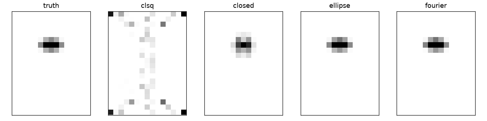

# closedshape: closed-shape shadow imaging of transit light curves

`closedshape` turns a transit light curve into a picture of the transiting object's silhouette (its "shadow image") in the style of [EightBitTransit](https://github.com/esandford/EightBitTransit) (Sandford & Kipping 2019). It differs from EightBitTransit in two ways:

1. **A more accurate forward model.** The occulter follows the real curved circular orbit instead of a straight line. Limb darkening is evaluated exactly with sub-pixel sampling. Pixels that straddle the stellar limb get partial coverage.
2. **A closed-shape prior** that removes the image-level degeneracies of shadow imaging. You can use it as:
   - a non-parametric *single connected, hole-free blob* inversion, or
   - parametric closed outlines: sphere, ellipse, or ellipse × Fourier deformation.

It keeps EightBitTransit's workflow (`TransitingImage(opacitymat / N, M, LDlaw, LDCs, v, t_ref, t_arr)`, `gen_LC`, `invertLC`, `plot_grid`). It is pure NumPy/SciPy, with no Cython and no GPU.


*Oblate occulter (f = 0.5, r = 0.15 R\*, b = 0.35), TESS-like noise. Panels: truth; plain pixel least squares (EightBitTransit-like CLSQ); closed-pixel inversion; ellipse fit; closed Fourier outline. Produced by `examples/quickstart.py`.*

## Why: the degeneracies of shadow imaging

A light curve is one-dimensional, but the image is two-dimensional. Many opacity grids produce exactly the same light curve:

- **Mirror (flip) degeneracy:** reflecting the image about the transit chord leaves the light curve unchanged. EightBitTransit therefore folds the grid and returns up/down-symmetric images.
- **Arc degeneracy:** opacity can be moved along arcs of constant distance from the stellar centre with little change in the light curve. This smears opacity into vertical streaks.
- **Stretch degeneracy:** a vertical stretch of the image can be traded against limb darkening and impact parameter.

On simulations, these make EightBitTransit's CLSQ images correlate only about 0.2–0.3 with the true silhouette. Their aspect ratios are off by about 3×, and are systematically too tall (see the benchmark below).

If you are willing to assume the occulter is **one closed object**, most of these solutions are ruled out:

- **One connected blob** removes the mirror ambiguity.
- **Compactness and smoothness** remove the arc streaks.
- **A parametric closed outline** turns the problem into a handful of well-constrained parameters.

This is a *stronger assumption*. Rings, tails, debris or multiple bodies violate it.

## Installation

```bash
git clone <your-fork-url> closed-shape-shadow-imaging
cd closed-shape-shadow-imaging
pip install -e .            # numpy, scipy, matplotlib
pip install -e ".[test]"    # + pytest, batman-package (for the batman comparison test)
pytest -q
```

Requires Python ≥ 3.9 and works with NumPy 2.x.

## Quickstart (EightBitTransit-style)

The EightBitTransit way:

```python
from EightBitTransit.cTransitingImage import TransitingImage
from EightBitTransit.inversion import invertLC
ti = TransitingImage(opacitymat=grid, LDlaw="nonlinear", LDCs=c, v=v, t_ref=0., t_arr=t)
lc, overlap_times = ti.gen_LC(t)
out = invertLC(N, M, v, 0., t, flux, err, "arcComb", LDlaw="nonlinear", LDCs=c)
```

The `closedshape` equivalent:

```python
import numpy as np
import closedshape as cs

c = [0.15, 1.2, -1.1, 0.36]                     # nonlinear (Claret) LD coefficients
t = np.arange(-0.075, 0.075, 60/86400.)          # days from mid-transit

# 1) forward: opacity grid -> light curve (same call pattern as EightBitTransit)
grid = cs.pixelize_ellipse(20, 15, 0.0, 0.35, 0.2, 0.1)
ti = cs.TransitingImage(opacitymat=grid, LDlaw="nonlinear", LDCs=c,
                        a=3.0, P=1.0,            # curved orbit; or v=... alone for EBT's straight path
                        t_ref=0.0, t_arr=t)
lc, t_out = ti.gen_LC(t)

# 2) inverse: light curve -> opacity grid
ti = cs.TransitingImage(N=20, M=15, LDlaw="nonlinear", LDCs=c, a=3.0, P=1.0,
                        t_ref=0.0, t_arr=t, fluxes=flux, errors=err)   # your normalised data
img = ti.invertLC(method="closed")              # single connected blob (recommended)
img_clsq = ti.invertLC(method="clsq")            # unregularised weighted CLSQ (EBT-like)
ell = ti.fit("ellipse")                          # dict: f, sig_f, b, r_area, chi2, dchi2_vs_sphere, opacitymat
fou = ti.fit("fourier", K=3)                     # closed star-convex outline
ti.plot_grid(save=True, filename="image.png"); ti.plot_LC(save=True, filename="lc.png")

# or the functional form with EightBitTransit's argument order:
img, ti = cs.invertLC(20, 15, v, 0.0, t, flux, err, "closed", LDlaw="nonlinear", LDCs=c, a=3.0)
```

### Command line

```bash
closedshape fold.txt --N 20 --M 15 --a 3.036 --P 1.0914185 \
    --ld-law nonlinear --ld 0.15 1.2 -1.1 0.36 --exptime 120 --normalize \
    --method all --out results/
```

The input is a text or CSV file with columns `time[d] flux [err]`, with time measured from mid-transit (or use `--t-ref`). The command writes:
- `summary.json` with the fits, rms, χ² and Δχ² vs sphere
- `opacitymat_<method>.txt/.png`
- `lightcurve.png`

`--method` is one of `closed | clsq | sphere | ellipse | fourier | all`. With `--v` and no `--a`, the path is straight, as in EightBitTransit.

### Examples

`python examples/quickstart.py` runs in about 5 s. It does two things:
- an oblate-planet injection/recovery comparing CLSQ, the closed-pixel inversion and the parametric fits;
- a WASP-12b-style fit (simulated; pass `--file fold.txt` to fit a real phase-folded light curve).

## API summary

| Object | Purpose |
|---|---|
| `TransitingImage(opacitymat=None, N=None, M=None, LDlaw, LDCs, v=None, a=None, P=None, b=0, t_ref=0, t_arr, fluxes=None, errors=None, exptime=None, supersample=1, ss=6)` | Main class. `.gen_LC(t_arr)`, `.invertLC(method, ...)`, `.fit(kind)`, `.design()`, `.plot_grid()`, `.plot_LC()`, `.fits` |
| `invertLC(N, M, v, t_ref, t_arr, obsLC, obsLCerr, method, LDlaw, LDCs, a=None, P=None, ...)` | Functional wrapper with EightBitTransit's argument order; returns `(opacitymat, TransitingImage)` |
| `Orbit(P, a, b, t_ref)` / `Orbit(v=..., b, t_ref)` | Curved circular orbit, or straight constant-velocity path |
| `make_intensity(law, coeffs)` | `uniform`, `linear`, `quadratic`, `nonlinear`, `poly` LD; returns `(I(mu), Ftot)` |
| `blocked_flux`, `pixel_design`, `grid_coords`, `supersample_times`, `rebin` | Forward model building blocks |
| `clsq(A, flux, sig, N, M, lam, mu, centre, support)` | Weighted bounded least squares, with optional smoothness and compactness penalties |
| `closed_pixel(A, flux, sig, N, M, lam=0.3, mu=10, centre)` | Closed-shape pixel inversion |
| `ShapeModel`, `fit_sphere`, `fit_ellipse`, `fit_fourier`, `f_to_e`, `e_to_f` | Parametric closed outlines |
| `pixelize_ellipse`, `image_metrics`, `load_lightcurve` | Utilities (mirror-invariant correlation, IoU, moment aspect ratio) |

Conventions:
- Units are stellar radii and days.
- x is the direction of motion. The grid has pixel width 2/N, and rows/columns follow EightBitTransit's `positions` convention.
- Flattening f > 0 means the outline is elongated along the motion.

### Differences from EightBitTransit's exact signatures

- `TransitingImage` takes explicit keyword arguments instead of `**kwargs`. `imfile`, `lowres`, `lowrestype` and `lowresround` are not supported. Pass `N`, `M` instead of an opacity grid when inverting.
- `gen_LC(t_arr)` returns `(LC, t_arr)` for **all** requested times. EightBitTransit returns only the times where the grid overlaps the star (`overlapTimes`).
- Inversion is a method (`ti.invertLC(method=...)`) as well as a function. The method names differ (see the table below). The function returns `(opacitymat, ti)` instead of EightBitTransit's multi-stage SART outputs.
- Extra arguments: `a`, `P`, `b` (curved orbit), `fluxes`, `errors`, `exptime`, `supersample`, `ss`.
- There is no `gpu=` flag.

## What changed vs EightBitTransit

| Aspect | EightBitTransit (Sandford & Kipping 2019; GPU fork) | closedshape |
|---|---|---|
| Path of the grid | Straight line at constant velocity `v` | Curved circular orbit `x = a sin φ`, `y = b cos φ` (rigid, non-rotating silhouette); straight line still available with `v` only. At a/R\* ≈ 3 the difference is ~10³ ppm |
| Limb darkening | Applied per pixel with a small-planet approximation (`LDfluxsmall`) | Exact I(μ) evaluated on ss×ss sub-pixels; laws uniform / linear / quadratic / nonlinear / poly |
| Pixels on the stellar limb | Pixel-area overlap geometry | Partial-cell coverage, with I(μ) averaged across the covered strip |
| Forward-model accuracy (sphere, r = 0.1, a = 3) | ≈1220 ppm max error vs squishyplanet/batman on a 20×15 grid | 19 ppm (n = 70 samples) / 5.6 ppm (n = 140) for parametric outlines |
| Exposure-time smearing | No | `exptime`, `supersample` |
| Least squares | CLSQ on a folded (symmetric) half-grid, unweighted | Full unfolded grid, noise-weighted (`errors`), bounds [0, 1] |
| Mirror (up/down) degeneracy | Folded away; images symmetric by construction | Broken by the single-blob prior (closed pixel) or a parametric outline; side chosen by the fitted impact parameter |
| Arc / stretch smearing | Present (vertical streaks) | Suppressed by smoothness, compactness and connected support, or eliminated by parametric outlines |
| Connectivity / closed shape | None | `closed_pixel`: largest connected component, holes filled, dilated support, refit |
| Parametric outlines | None | Sphere, axis-aligned ellipse, ellipse × exp(Fourier K) star-convex outline, with σ_f and Δχ² vs sphere |
| SART, arcAvg, arcPars, arcComb, wedge rearrangement | Yes | **Not included** (use EightBitTransit for these) |
| Image-file input (`imfile`, low-res modes) | Yes | No |
| NumPy 2 compatibility | Needs patches (`np.int`, `np.in1d`, Cython dtype declarations) | Native |
| Compiled code / GPU | Cython (original); CuPy GPU path (fork) | Pure NumPy/SciPy, CPU only |

## Benchmark summary

These are from the accompanying injection/recovery study, which is not part of this repo.

Setup:
- squishyplanet oblate truths with r_area ∈ {0.05, 0.1, 0.25, 0.4} and f1 ∈ {0, 0.25, 0.5, 0.75}; P = 1 d, a/R\* = 3.
- TESS-like (20×15 grid, 60 s, 300 ppm), CHEOPS-like (12×12, 120 s, 360 ppm) and JWST-like (33×27, 20 s, 171 ppm) configurations.
- b = 0.35 for all three, plus b = 0 for TESS.
- Per case: 1 noiseless and 2 noisy realizations, 192 fits in total.
- Every method saw the same light curves. a/R\* and P were fixed.

| Method | Image correlation (mirror-invariant) | IoU | Median abs(f_rec − f_true) | Noiseless LC misfit |
|---|---|---|---|---|
| EightBitTransit CLSQ (baseline) | 0.20–0.27 | ≤ 0.07 | 0.72–0.86 (aspect off ~3×) | 76–358 ppm |
| Corrected forward model, plain CLSQ | 0.24–0.38 | 0.03–0.16 | 0.73–0.89 | 5–206 ppm |
| Closed pixel (single blob) | 0.87–0.95 | 0.35–0.75 | 0.19–0.38 | 129–261 ppm |
| Ellipse fit | 0.96–1.00 | 0.49–0.99 | 0.01 | 15–18 ppm |
| Closed Fourier outline (K = 3) | 0.96–1.00 | 0.48–0.99 | 0.01 | 13–17 ppm |

**Telling oblate from spherical (a/R\* fixed).** An oblate truth is flagged when |f|/√(σ_f² + 0.02²) > 3 *and* Δχ²(sphere − ellipse) > 9:
- TESS: 83% of noisy oblate realizations.
- CHEOPS: 67–71%.
- JWST: 100%.
- 0 false positives on f = 0 truths.
- The misses are r = 0.05 planets, and r = 0.1 with f1 = 0.25 for CHEOPS.

**Key caveat: a/R\* must be known.** With a/R\* free, a *sphere* at a shifted (b, a/R\*) reproduces an oblate light curve:
- TESS, r = 0.1: Δχ² drops from 15 / 115 / 645 (f1 = 0.25 / 0.5 / 0.75) to **0.0 / 0.2 / 1.3**.
- JWST, r = 0.1: it drops from 197 / 1441 / 7781 to 0.2 / 1.5 / 14.8.
- The closed-shape prior fixes the *image* degeneracies, not the photometric oblateness ↔ (a, b) degeneracy.

**WASP-12b (TESS, 288 × 60-s folded bins).** Settings: a/R\* = 3.036, P = 1.0914185 d, nonlinear LD (0.15, 1.2, −1.1, 0.36), 120-s supersampling.
- Ellipse fit: f = −0.016 ± 0.046 (Δχ² vs sphere 0.13).
- Closed Fourier fit: f = −0.034 ± 0.050 (Δχ² = 7.7 for 6 extra parameters, not significant).
- Both are consistent with a sphere and with the expected Roche flattening of about +0.05. Oblateness is not detected.
- f shifts by about 0.26 for a ±2% change in a/R\*.

## Limitations and caveats

- **The closed-shape prior is an assumption.** It is wrong for rings, tails, exospheres, multiple bodies or spotted, non-convex shapes, and in those cases it will bias the image.
- The ellipse benchmarks use truths drawn from the same family, so they are optimistic. The generic Fourier outline performs similarly.
- Oblateness sensitivity requires an independent a/R\* (stellar density, or RV plus stellar radius). Limb darkening is assumed known; freeing it adds a further degeneracy with f.
- There is a systematic floor of about 0.01 in f for large planets, from point-sampling discretization (`n = 70`) and LD-approximation differences. Increase `n` in `TransitingImage.fit(..., n=)` for high-SNR data.
- The closed-pixel inversion pulls f towards 0 because of its isotropic compactness term, and it can clip blobs on very coarse grids (≤ 12×12). The defaults `lam = 0.3` and `mu = 10` were tuned on TESS-like simulations.
- The silhouette is assumed rigid and non-rotating: its sky-projected shape is constant during transit. Orbits are circular.
- There is no SART or arc-combinatorics machinery. For those, and for exact EightBitTransit reproduction, use EightBitTransit itself.

## Citation

If you use this code, please cite:
- **EightBitTransit / shadow imaging:** Sandford, E. & Kipping, D. 2019, *AJ* 157, 42, "Shadow Imaging of Transiting Objects", and the EightBitTransit software (https://github.com/esandford/EightBitTransit). If you used it, also cite the GPU fork by D. Giles.
- **squishyplanet**, if you used it to generate oblate truths or for comparisons: Cassese, B. et al., the `squishyplanet` package (https://github.com/ben-cassese/squishyplanet).
- **batman**, if you used it for comparisons: Kreidberg, L. 2015, *PASP* 127, 1161.
- This repository (`closedshape`). Add a `CITATION.cff` or Zenodo DOI once the repository is public.

## License

MIT; see `LICENSE`. EightBitTransit and its GPU fork are MIT-licensed. This package contains no EightBitTransit source code: the interface and grid conventions are modelled on it and are attributed in `LICENSE`.
